<div align="center">


# nosDshell

### 经典 deepin 15 毛玻璃美学 × Noctalia v4 全套桌面能力，开箱即用的 Wayland 桌面外壳

[English](README_EN.md) · [Wiki 文档](https://shinebreaker.github.io/nosDshell/) · [设计规范](DESIGN.md) · [更新日志](CHANGELOG.md)

[](https://github.com/ShineBreaker/nosDshell/releases)
[](LICENSE)
[](https://wayland.freedesktop.org)
[](https://quickshell.outfoxxed.me)
[](https://shinebreaker.github.io/nosDshell/)

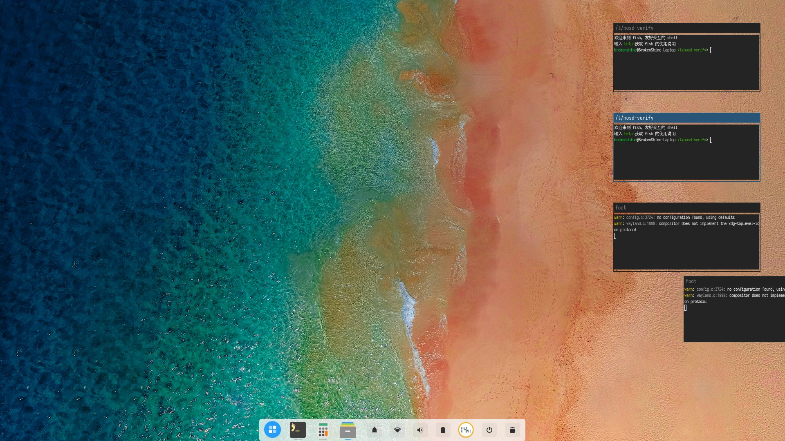

</div>

---

## 简介

Wayland 平铺与滚动合成器（Niri、Hyprland、Sway 等）轻快高效，但要围绕它们搭起一套完整的日常桌面，往往需要分别配置状态栏、启动器、通知守护进程、锁屏、壁纸工具、权限认证弹窗和深色模式同步脚本。

**nosDshell** 用一个进程接管整套桌面体验。它基于 [Quickshell](https://quickshell.outfoxxed.me) 构建，完整继承 [Noctalia](https://github.com/noctalia-dev/noctalia-shell) v4 的业务内核，并按 **deepin 15（DDE 15）** 的视觉与交互规范重做了每一处界面：近黑或浅白毛玻璃、细腻的发丝描边、标志性的深度蓝 `#2CA7F8`，以及从任务栏、控制中心到锁屏和 Polkit 认证的统一体验。

---

## 为什么选择 nosDshell

- **经典 DDE 15 视觉，像素级考据。** 尺寸、透明度、圆角和动效曲线均取自 [GXDE-OS](https://github.com/GXDE-OS)（DDE 15 社区维护版）源码，在 [`DESIGN.md`](DESIGN.md) 中逐项标注源文件与行号。针对现代高分屏补充的发丝描边、柔和投影和跟随主题的通知气泡，在规范中明确标为〔演进〕。
- **一个进程配齐整套桌面。** 内置任务栏、可选顶部状态栏、全屏与迷你启动器、右侧滑出式控制中心、应用分组通知、音量与亮度 OSD、壁纸选择器、锁屏、全屏关机界面，以及原生的 Polkit 提权认证对话框，无需再拼装零散组件。
- **双形态任务栏与可选状态栏。** 随时在居中的"时尚模式"悬浮任务栏与贴边通栏的"高效模式"之间切换，支持上、下、左、右四个停靠方向。高效模式支持左、中、右三区插件自由编排；时尚模式下还可额外开启独立的 macOS 式状态栏。
- **全桌面统一的明暗切换与壁纸取色。** 毛玻璃表面与 `*-symbolic` 单色图标随亮色、暗色主题自动切换，也支持从当前壁纸提取调色板并生成 GTK、终端与编辑器配色。内置兼容 `darkman` 与 `xdg-desktop-portal` 的单进程守护服务，让 GTK4、Qt、Electron 应用与 `~/.local/share/{dark,light}-mode.d/` 脚本共用同一份明暗状态。
- **跨合成器支持与内置实用插件。** 原生适配 Niri、Hyprland、Sway、Scroll、Labwc、MangoWC 六种 Wayland 合成器，支持多显示器独立配置、桌面挂件与设置自动迁移。随包内置 USB 存储管理插件（一键挂载、查看容量、安全断电弹出）与 Niri 概览直输搜索插件（在概览视图下直接打字即可唤出启动器搜索）。
- **干净纯粹，零遥测打扰。** 移除了上游的遥测上报、内置更新提示和赞助者展示等品牌服务，以及在 DDE 布局下没有对应物的锁屏、会话菜单和面板选项（完整移除清单见 [`DESIGN.md`](DESIGN.md) §6.1）。版本更新统一交由系统包管理器。

---

## 界面预览

| 亮色主题 | 暗色主题 |
|:---:|:---:|
|  | 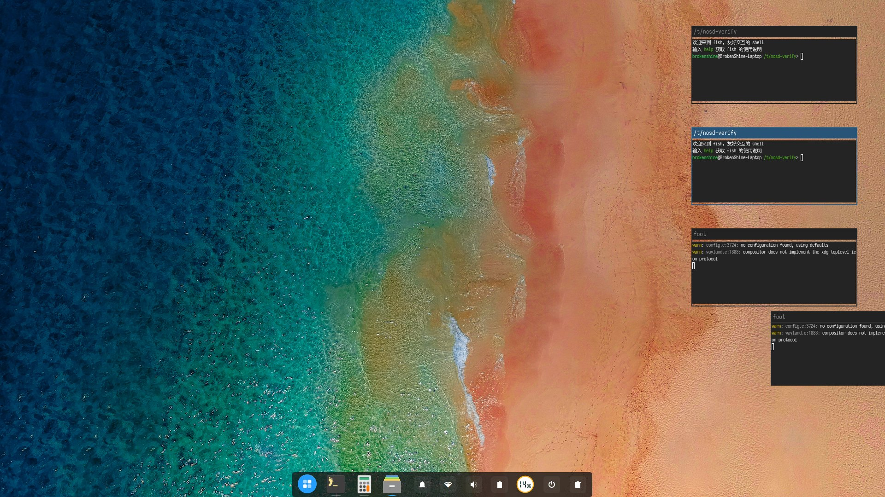 |
| 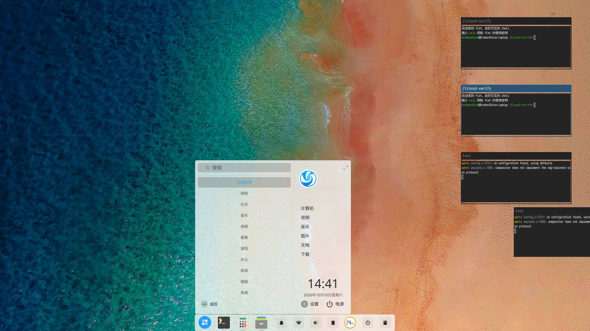 | 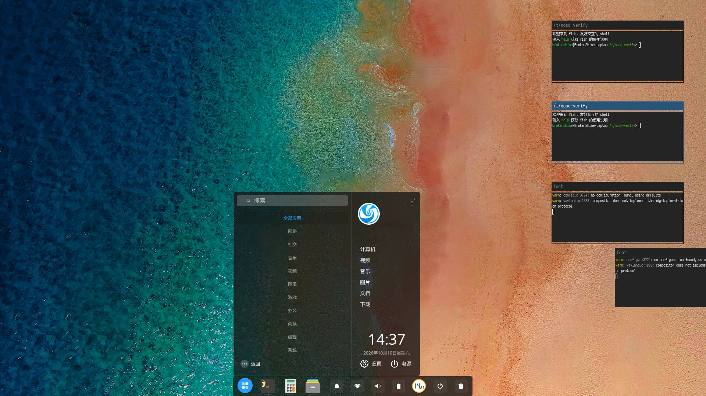 |
| 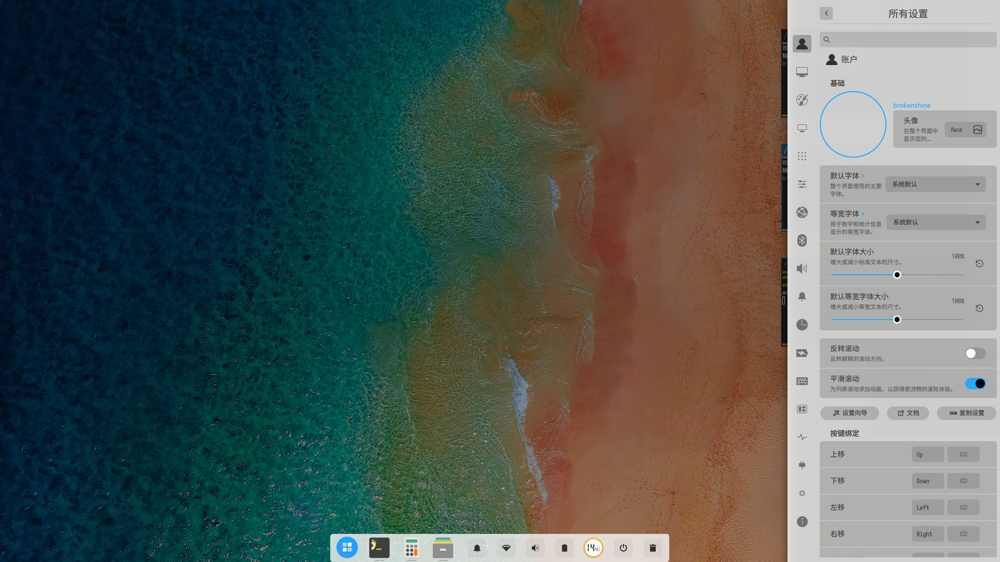 | 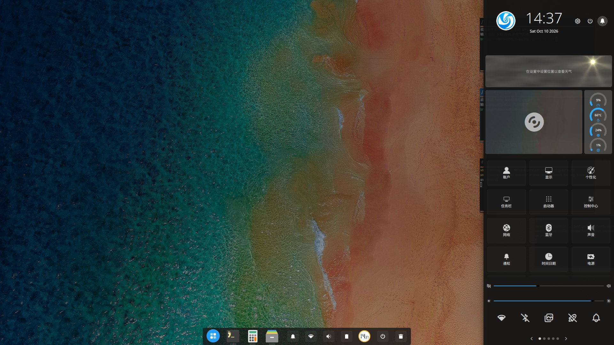 |

<details>
<summary><b>展开更多界面截图</b></summary>

| | |
|:---:|:---:|
| **全屏启动器**（壁纸背景保持深色） | **高效模式任务栏** |
| 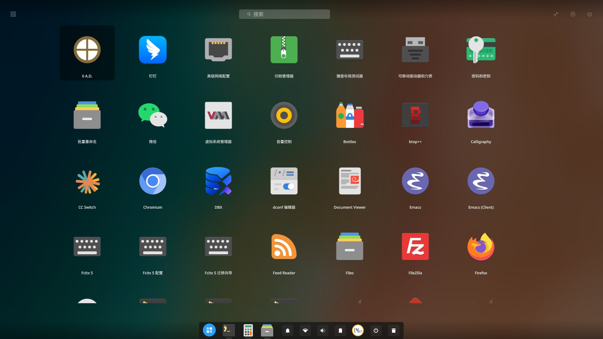 | 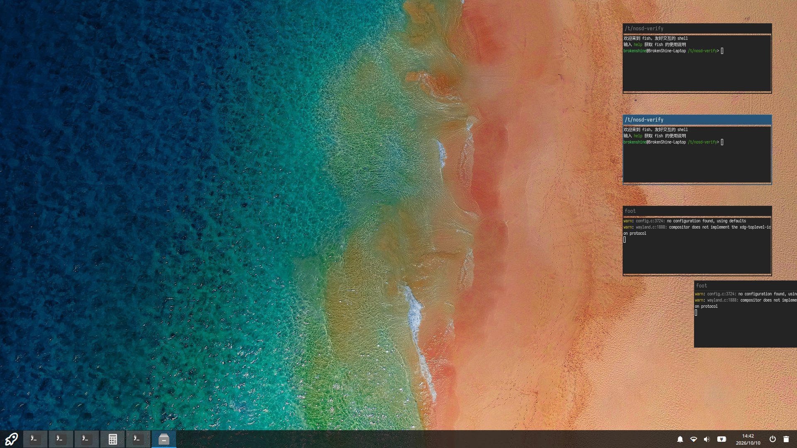 |
| **任务栏弹出面板** | **控制中心（亮色）** |
| 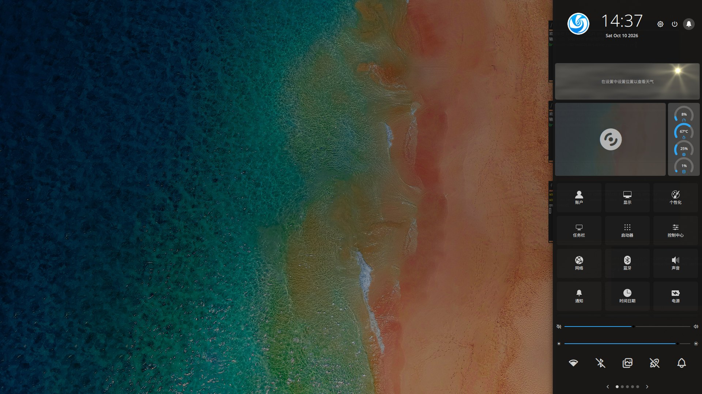 | 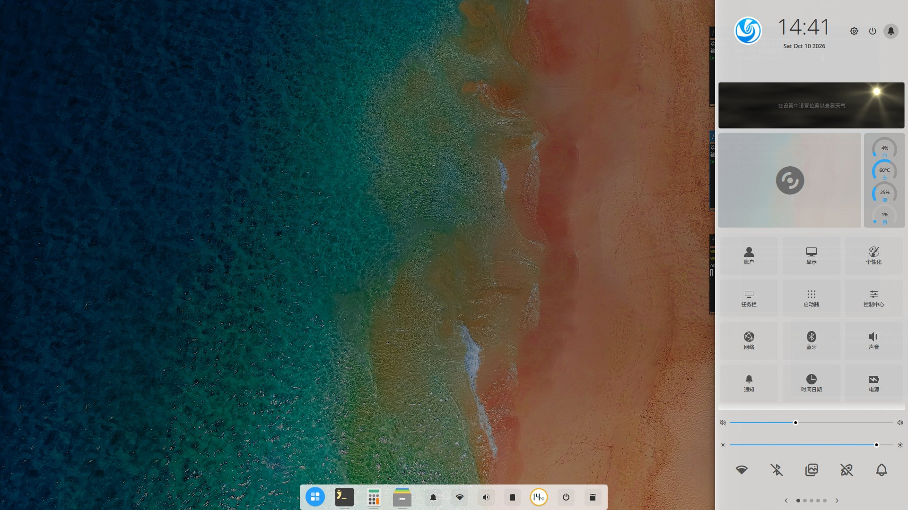 |
| **通知气泡** | **OSD 状态提示** |
| 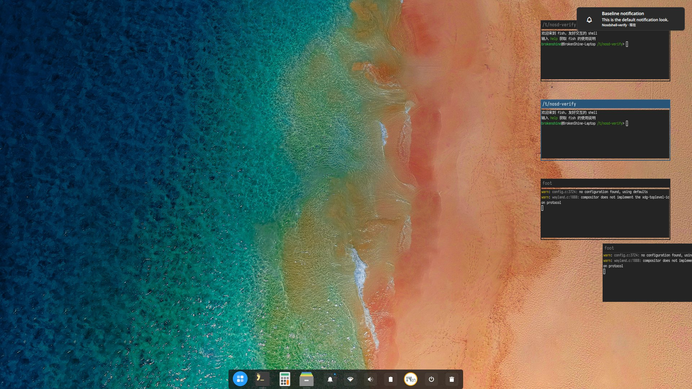 | 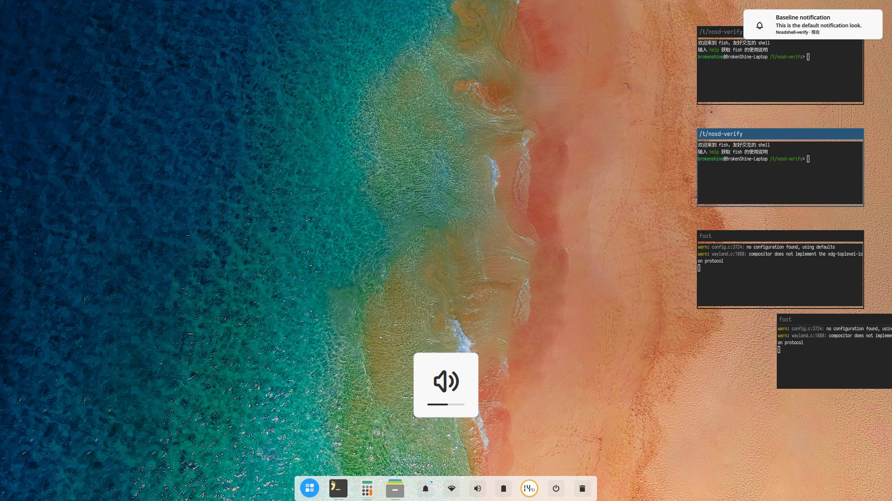 |
| **全屏关机界面** | **锁屏** |
| 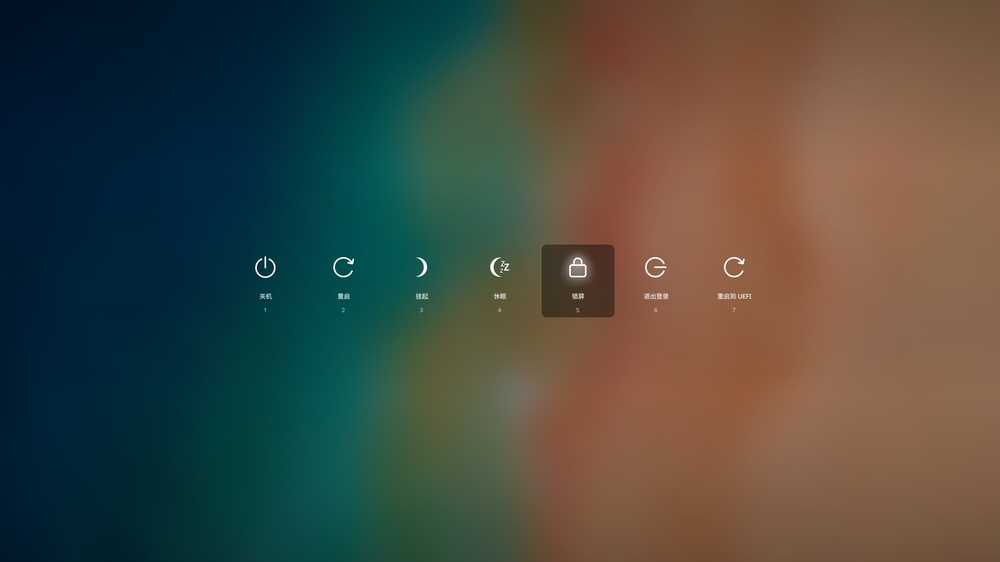 | 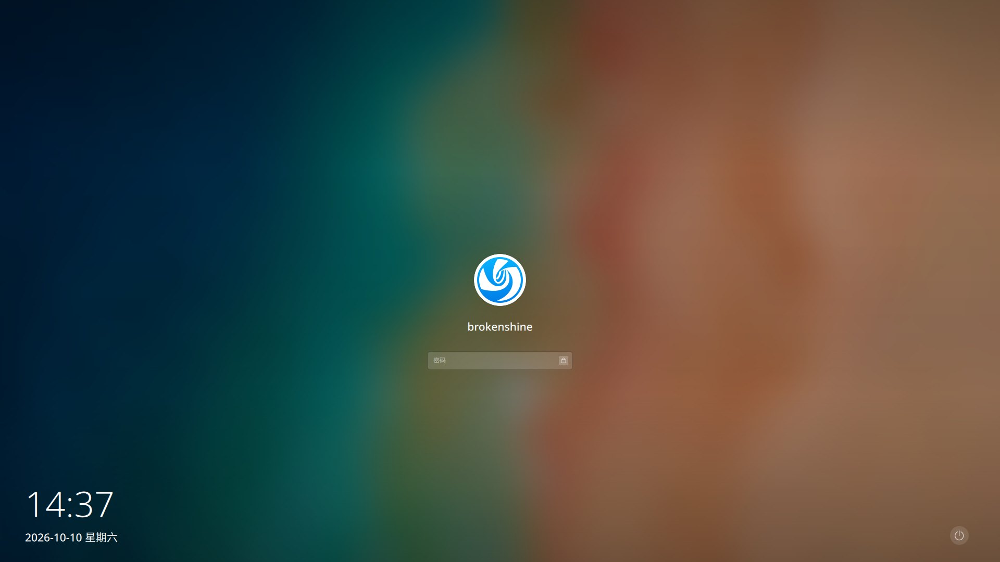 |

</details>

---

## 核心界面一览

- **任务栏与弹出面板。** 时尚模式居中悬浮，高效模式占满屏幕边缘，四种停靠方向任意切换。应用运行指示条、多窗口合并、固定驻留和拖拽排序均遵循 DDE 15 规则；点击音量、Wi-Fi、蓝牙、电池、日历或 USB 插件时，弹出指向对应图标的带箭头毛玻璃气泡。
- **应用启动器。** 全屏模式在预模糊壁纸上平铺应用网格，支持左侧 11 类应用导航，打开期间任务栏仍可正常操作。迷你模式紧贴任务栏弹出，支持两级分类浏览与常用目录直达。两种模式均支持直接打字搜索应用、已打开窗口、系统设置、剪贴板历史、表情符号、四则运算与 Shell 命令。
- **控制中心与设置。** 从屏幕右侧滑出 408 px 宽的抽屉面板。默认首页展示按日期分段、按同一应用折叠的通知列表；底部集成可收起的分页快捷控制区，包含天气、媒体播放、系统监控表盘、音量与亮度滑条，以及最多 10 个带文字标签的快捷开关。点击齿轮或模块格子即可进入带 56 px 左侧图标导航条的设置视图。
- **锁屏与关机界面。** 锁屏以预模糊壁纸为背景，底部展示大号时钟、日期、媒体控制与电源入口，中央提供头像、密码或指纹验证，以及密码错误与大写锁定提示。关机界面在屏幕中央排开 140x140 的电源操作按钮（关机、重启、待机、休眠、锁定、注销、重启到 UEFI），支持方向键与数字键快捷选择。
- **OSD、通知气泡与权限认证。** 调节音量、亮度或切换锁定键时，屏幕底部居中浮现 140x140 的 OSD 方块，连续调节时就地更新数值而不重播动画。新通知以 300 px 宽的气泡在右上角排队呈现。需要管理员权限的操作会直接弹出 DDE 风格的 Polkit 密码对话框，并自动将临时 systemd 单元名解析为实际执行的命令。

---

## 快速开始

### 运行环境

- **Wayland 合成器**：Niri、Hyprland、Sway、Scroll、Labwc 或 MangoWC
- **[Quickshell](https://quickshell.outfoxxed.me)**：0.3.x
- **图标主题**：推荐 Papirus 或 deepin
- **可选命令行工具**（缺失时仅对应功能不可用）：`brightnessctl`、`ddcutil`、`wlsunset`、`wl-clipboard`、`cliphist`、`cava`、`power-profiles-daemon`、`udisksctl`，各工具用途见 [`CREDITS.md`](CREDITS.md)

### 安装与运行

#### Guix

本仓库即 Guix channel（`.guix-channel`）。在 `~/.config/guix/channels.scm` 中加入：

```scheme
(cons* (channel
        (name 'nosdshell)
        (url "https://github.com/ShineBreaker/nosDshell")
        ;; 跟踪 main；要装某个发行版可改为 (branch "v1.7.0")
        (branch "main"))
       %default-channels)
```

然后 `guix pull` 并安装：`guix install nosdshell`。channel 的每个提交打包其自身源码树，所以 pin 到 tag 得到的就是对应版本。

开发态构建（打包当前工作区而非远端提交）：`guix build -f nosdshell.scm`。

#### Nix / NixOS

`flake.nix` 提供软件包 `packages.<system>.default`、overlay `overlays.default`、Home Manager 模块 `homeModules.default`（`programs.nosdshell`）与 NixOS 模块 `nixosModules.default`（`services.nosdshell`）。

NixOS（在你的 flake 里）：

```nix
{
  inputs.nosdshell.url = "github:ShineBreaker/nosDshell";

  outputs = { nixpkgs, nosdshell, ... }: {
    nixosConfigurations.<主机名> = nixpkgs.lib.nixosSystem {
      modules = [
        nosdshell.nixosModules.default
        { services.nosdshell.enable = true; }
      ];
    };
  };
}
```

Home Manager：

```nix
{
  inputs.nosdshell.url = "github:ShineBreaker/nosDshell";

  outputs = { home-manager, nosdshell, ... }: {
    homeConfigurations.<用户名> = home-manager.lib.homeManagerConfiguration {
      modules = [
        nosdshell.homeModules.default
        { programs.nosdshell.enable = true; }
      ];
    };
  };
}
```

临时试用不改配置：`nix run github:ShineBreaker/nosDshell`。

#### 其他发行版

克隆本仓库，执行 `qs -p <仓库路径>` 启动。

安装完成后，可执行 `nosdshell --version` 查看当前 shell 与 Quickshell 版本。`bash`、`zsh` 与 `fish` 的命令行补全脚本随包安装至标准目录，新开终端即可生效。

---

## 文档导航

- **[Wiki 文档站](https://shinebreaker.github.io/nosDshell/)**：完整托管上游 Noctalia v4 文档存档（安装配置、主题模板、插件开发、IPC 接口参考）。
- **[`DESIGN.md`](DESIGN.md)**：DDE 15 视觉与交互设计规范，所有界面表现以该规范为准。
- **[`AGENTS.md`](AGENTS.md)**：工程架构与维护规范，按任务类型关联 [`CODING_STANDARDS.md`](CODING_STANDARDS.md)、[`DEBUGGING.md`](DEBUGGING.md) 与 [`TOOLS.md`](TOOLS.md)。
- **[`CHANGELOG.md`](CHANGELOG.md)** 与 **[`docs/RELEASE.md`](docs/RELEASE.md)**：版本演进记录与发版流程。

---

## 开发与验证

常用开发命令已封装在 `justfile` 中，执行 `just` 可查看全部命令：

| 目标 | 命令 |
|---|---|
| 静态检查（配置键、翻译、动效、QML 语法） | `Scripts/dev/lint.sh [--changed]` |
| 在隔离环境中运行并自动截图验证 | `Scripts/test/verify.sh <名字> [--settings seed.json] [--scenes a,b]` |
| 在嵌套 Niri 窗口中做真机验证 | `Scripts/test/niri/` |
| 启动与面板开合性能基准测试 | `Scripts/test/bench.sh` |
| 格式化 QML 源码 | `Scripts/dev/qmlfmt.sh <路径>` |

---

## 许可证

本项目以 GPL-3.0 许可证分发，详见 [LICENSE](LICENSE)。
继承自上游 Noctalia 的代码仍保留 MIT 许可证，详见 [LICENSE-MIT](LICENSE-MIT)。

## 致谢

- **[Noctalia](https://github.com/noctalia-dev/noctalia-shell)**：提供本项目的功能内核（v4 分支），其 v4 文档存档托管于本项目 Wiki。
- **[GXDE-OS](https://github.com/GXDE-OS)**：DDE 15 的社区维护版本，提供设计规范中的源码级数值依据。默认壁纸 `deepin15-desktop.jpg` 取自其壁纸仓库（CC-BY-3.0 © UnionTech）。
- **deepin / DDE 15**：这套经典桌面视觉与交互语言的原作者。

完整致谢与第三方依赖说明见 [`CREDITS.md`](CREDITS.md)。
