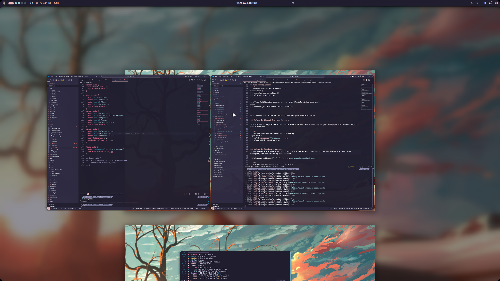
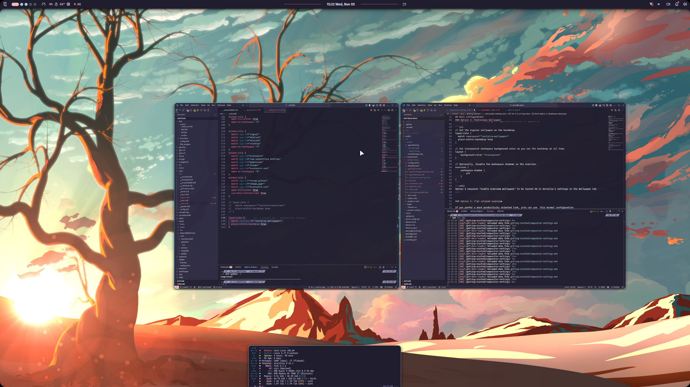
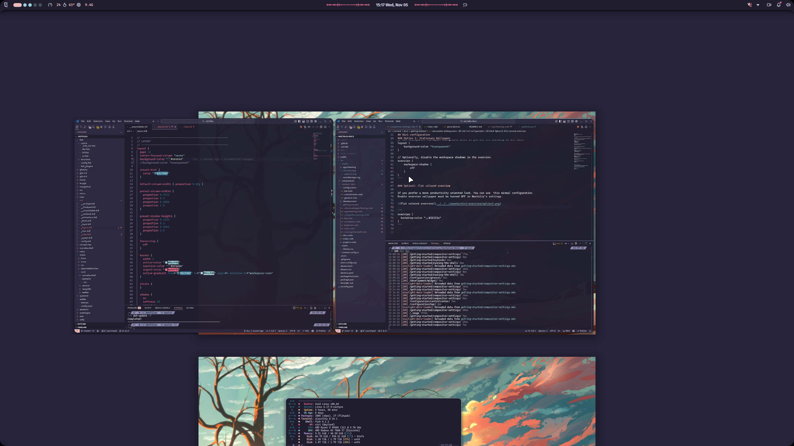

<!-- generated by Scripts/docs/vendor-legacy-docs.py; do not hand-edit -->


Add the following settings to your Niri configuration file (usually located at `~/.config/niri/config.kdl`).

These settings are for general window appearance and functionality.

```ini
window-rule {
  // Rounded corners for a modern look.
  geometry-corner-radius 20

  // Clips window contents to the rounded corner boundaries.
  clip-to-geometry true
}

debug {
  // Allows notification actions and window activation from Noctalia.
  honor-xdg-activation-with-invalid-serial
}
```

## Wallpapers setup

Next, choose one of the following options for your wallpaper and overview setup.

> **Note**
> The "backdrop" in Niri is a layer behind all workspaces that is visible when you trigger the overview mode.


### Option 1: Blurred Overview Wallpaper

This minimal configuration allows you to have a blurred and dimmed copy of your wallpaper that appears only in Niri's overview.




```ini
// Set the overview wallpaper on the backdrop.
layer-rule {
  match namespace="^nosdshell-overview*"
  place-within-backdrop true
}
```
> **Note**
> Option 1 requires "Enable overview wallpaper" to be turned ON in Noctalia's settings on the Wallpaper tab. It also uses more memory as it handles an extra wallpaper per monitor.


### Option 2: Stationary Wallpaper

If you prefer a stationary wallpaper that is visible at all times and does not scroll when switching workspaces, use the following configuration.




```ini
// Set the regular wallpaper on the backdrop.
layer-rule {
  match namespace="^nosdshell-wallpaper*"
  place-within-backdrop true
}

// Set transparent workspace background color so you see the backdrop at all times.
layout {
  background-color "transparent"
}

// Optionally, disable the workspace shadows in the overview.
overview {
  workspace-shadow {
    off
  }
}
```
> **Note**
> Option 2 requires "Enable overview wallpaper" to be turned OFF in Noctalia's settings on the Wallpaper tab.


### Option 3: Flat Colored Overview

If you prefer a more productivity-oriented look, you can use this minimal configuration.




```
overview {
  // Choose your favorite color.
  backdrop-color "#26233a"
}
```

> **Note**
> Option 3 requires "Enable overview wallpaper" to be turned OFF in Noctalia's settings on the Wallpaper tab.


## Blur

> **Warning**
> Blur support was introduced in Niri version 26.04. Adding these rules to earlier versions of Niri will result in configuration errors.


You can enable blur behind windows and Noctalia's bar, panels, and dock.

```ini
/* Apps: blur them all without xray for a better look */
window-rule {
  background-effect {
    blur true
    xray false
  }
}

/*
  nosDshell layer rules for niri ≥ 26.04.

  nosdshell publishes its own blur regions via ext-background-effect — niri
  honors them with NO `blur` flag at all, exactly where the shell asks.
  NEVER set `blur true` on a nosdshell *surface* rule: in niri that means
  "blur the surface's whole extent, transparent parts included", and most
  nosdshell surfaces are fullscreen planes — that is the giant-blur bug.
  `blur true` is only safe inside `popups {}`, where the surface is always
  sized to its card.

  Equally, NEVER pin `blur false` on a surface that publishes regions or
  fills translucent masks: `blur false` force-disables even the client's
  own ext-background-effect regions, so a mask fills over sharp content
  (the 2026-10 popupmenu dialog regression). `blur false` is only for
  surfaces that paint no translucent mask at all.

  Three tiers, cheapest first:

    Tier 0  no blur     — surfaces never translucent over meaningful
                          content, or drawing their own backdrop already.
    Tier 1  xray blur   — wallpaper-sampled blur (xray is niri's default
                          for layer surfaces). Right for surfaces whose
                          only backdrop is the wallpaper anyway.
    Tier 2  real blur   — `xray false` on the region publishers that float
                          over arbitrary windows; translucency then shows
                          the actual window stack, not just the wallpaper.

  Canonical copy: nosDshell repo, Scripts/docs/nosdshell-layer-rules.kdl
  (check-layer-namespaces.py keeps it in sync with emitted namespaces).
*/

// Tier 2 — region publishers floating over windows: the bar strip and every
// open panel (hosted by nosdshell-background), the fashion dock, the mini
// launcher, the popupmenu plane while it hosts a dialog (widget/plugin
// settings, color/file pickers), notification bubbles, toasts, the OSD
// tile, and the polkit auth dialog. These must blur the real window stack.
layer-rule {
  match namespace="^nosdshell-(background|dock|popupmenu|notifications|toast|osd)-.*$"
  match namespace="^nosdshell-polkit$"
  match namespace="^nosd-launcher-mini-.*$"
  background-effect {
    xray false
  }
}

// Tier 1 — wallpaper-sampled blur: the fullscreen launcher wants the
// "blurred wallpaper" look, and desktop widgets at WlrLayer.Bottom only
// ever float over the wallpaper. xray samples the backdrop only, which is
// both the right aesthetic and the cheap path.
layer-rule {
  match namespace="^nosd-launcher-full-.*$"
  match namespace="^nosdshell-desktop-widgets-.*$"
  background-effect {
    xray true
  }
}

// Menus (TrayMenu, NPopupContextMenu, DockMenu) and tooltips are
// xdg_popups of these layer surfaces. Arrow-shaped popups have transparent
// pixels inside the surface rect (the margins beside the arrow), where a
// whole-surface blur would show through as a stray band — so each
// PopupWindow publishes its opaque body as an ext-background-effect blur
// region (NArrowRect.bodyItem + NSurfaceRegion), and niri follows the
// client region exactly. `blur true` here keeps whole-surface blur as the
// fallback for popups that don't publish a region; `blur false` would
// force-disable even client regions.
layer-rule {
  match namespace="^nosdshell-"
  match namespace="^nosd-launcher-"
  popups {
    background-effect {
      blur true
      xray false
    }
  }
}

// Tier 0 — never blur, never translucent: wallpaper IS the blur source;
// overview, session menu and the setup wizard draw their own pre-blurred
// backdrop; bar-content reveals background's already-blurred regions (a
// second pass would double it); fade-overlay is a dimming veil, not a
// glass mask; the rest are invisible helpers. Plugin-owned overlays
// (nosdshell:*) are invisible input-capture planes by convention.
layer-rule {
  match namespace="^nosdshell:"
  match namespace="^nosdshell-(wallpaper|overview|bar-content|bar-exclusion|bar-trigger|screen-detector|image-cache-renderer|fade-overlay|session-menu|setup-wizard)(-.*)?$"
  background-effect {
    blur false
  }
}
```

You can also fine-tune the blur effect globally:

```ini
blur {
  passes 2        // more passes = stronger blur (default: 3)
  offset 3.0      // sample distance per pass (default: 3.0)
  noise 0.03      // grain overlay (default: 0.02)
  saturation 1.0  // color saturation boost (default: 1.5)
}
```

> **Fine-tuning the blur effect**
> Adjust the blur parameters above alongside these Noctalia transparency settings to achieve your desired look:
>
> - **Panel background opacity** - Controls panel transparency
> - **Bar background opacity** - Controls bar transparency (optional)
> - **Translucent widgets** - Controls widget transparency within panels

